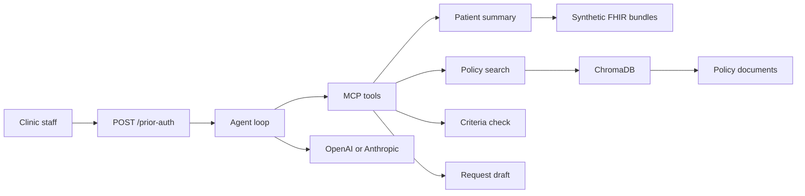

# Prior Authorization Agent

**Work in progress.** The dataset is in the repo. The agent, API, and evaluation are not built yet.

Clinic staff use this agent to prepare a prior authorization request. Given a patient id and a procedure, it reads the synthetic chart, finds the insurer's coverage rules, checks which criteria are met, and either drafts the request with policy citations or lists the information that is still missing.

All patients and policies are fictional. There is no real patient data.

## Planned architecture

Tool logic stays separate from the MCP server so the tools can be tested without a model. The provider is chosen with `LLM_PROVIDER`. Policy search uses ChromaDB and `all-MiniLM-L6-v2`. The API is one FastAPI endpoint.

## Roadmap

- [x] **Step 1 — Synthetic data.** 10 FHIR R4 patient bundles and 5 policy documents (knee MRI, lumbar spine MRI, CPAP, GLP-1, physical therapy), with covered indications, required documentation, and exclusions.
- [x] **Step 2 — Tool logic and tests.** `get_patient`, `search_policy`, `check_criteria`, and `draft_request`, with pytest coverage including unknown patients, unknown procedures, and empty results.
- [ ] **Step 3 — MCP server.** Expose the four tools with FastMCP and verify them in the MCP Inspector.
- [ ] **Step 4 — Agent loop.** Tool calling with a step limit, failed-call handling, a structured final result, and a log of each call, its arguments, latency, and tokens.
- [ ] **Step 5 — FastAPI endpoint.** `POST /prior-auth` returns the decision, draft, citations, and step trace.
- [ ] **Step 6 — Evals.** 20 cases with expected decisions and cited sections. Report decision accuracy, citation precision and recall, and average tool calls, latency, and token cost.
- [ ] **Step 7 — README.** Problem, architecture diagram, how to run, design tradeoffs, evaluation results, limitations, and next steps.

## License

MIT. See [LICENSE](LICENSE).
