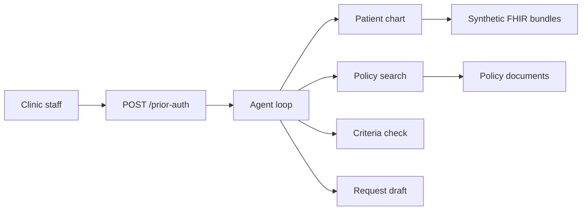

# Prior Authorization Agent

Clinic staff need a prior authorization packet before an insurer will cover a procedure. This project is an agent that reads a synthetic chart, finds the matching coverage policy, and either drafts the request or lists what is still missing.

All patients and policies in this repository are fictional. There is no real patient data.

## What is here now

The repository currently contains the synthetic dataset the agent will use:

- 10 FHIR R4 patient bundles in `data/patients/`
- 5 payer policy documents in `data/policies/`

Each policy has stable section ids, covered indications, required documentation, exclusions, and a decision guide with three outcomes: ready to submit, missing information, or not covered. The chart date for every bundle is 15 March 2026 (`Bundle.timestamp`).

The tools, model loop, API, and evaluation run are the next steps. This README will be updated when those exist. There is no evaluation table yet, because the eval set has not been run.

## How a chart lines up with a policy

| Patient | Knee MRI | Lumbar spine MRI | CPAP | GLP-1 | Physical therapy |
| --- | --- | --- | --- | --- | --- |
| pat-001 Elena Vasquez | Ready | Not covered | Not covered | Not covered | Missing a new referral |
| pat-002 Marcus Chen | Missing x-ray and 6 weeks of care | Not covered | Not covered | Not covered | Missing a referral |
| pat-003 Aisha Rahman | Not covered | Ready | Not covered | Missing a current A1c | Missing a new referral |
| pat-004 James Okonkwo | Not covered | Missing the neurologic exam | Not covered | Not covered | Missing a referral |
| pat-005 Priya Shah | Not covered | Not covered | Ready | Not covered | Not covered |
| pat-006 David Nguyen | Not covered | Not covered | Missing a sleep study and order | Not covered | Not covered |
| pat-007 Sofia Alvarez | Not covered | Not covered | Not covered | Ready | Not covered |
| pat-008 Robert Kim | Not covered | Not covered | Not covered (AHI under 5) | Not covered (type 1 diabetes) | Not covered |
| pat-009 Hannah Brooks | Not covered (osteoarthritis only) | Not covered | Not covered | Not covered | Ready |
| pat-010 Liam Patel | Not covered | Not covered (axial pain only) | Not covered | Not covered | Not covered (wellness, 14 visits) |

## Planned shape



The policy text stays separate from the tool code so the tools can be tested without the model.

## Configuration

Copy the example file and fill in keys only on your machine:

```bash
copy .env.example .env
```

`.env` is gitignored. `.env.example` is committed with blank values. Do not put API keys in either file in git.

## License

MIT. See [LICENSE](LICENSE).
